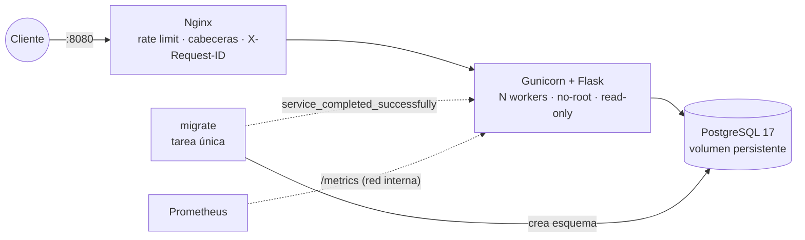
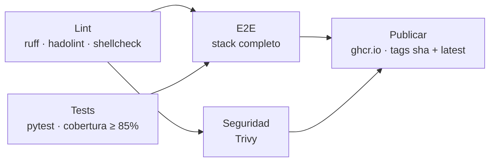

<h1 align="center">🐍 flask-production-template</h1>

<p align="center">
  Una app Flask como se corre <b>en producción</b>: contenedores endurecidos, healthchecks,<br/>
  métricas Prometheus, logs estructurados y un pipeline CI/CD que prueba, escanea y publica la imagen.
</p>

<p align="center">
  <a href="https://github.com/osvaldo96-reyes/flask-production-template/actions/workflows/ci.yml"></a>
  
  
  
  
</p>

---

La lógica de negocio es mínima (una API de notas) a propósito: lo interesante es **todo lo que la rodea**. Son los patrones que aplico al llevar aplicaciones Flask reales a producción con Docker.

## Arquitectura



## Inicio rápido

```bash
git clone https://github.com/osvaldo96-reyes/flask-production-template.git
cd flask-production-template
cp .env.example .env          # cambia POSTGRES_PASSWORD
make up                       # build + arranque; espera a que todo esté healthy

curl -X POST localhost:8080/api/notes -H 'Content-Type: application/json' -d '{"title":"hola"}'
curl localhost:8080/api/notes
```

O sin compilar, con la imagen ya publicada por el pipeline:

```bash
IMAGE=ghcr.io/osvaldo96-reyes/flask-production-template:latest docker compose up -d --no-build
```

## Qué incluye

| Área | Implementación |
|---|---|
| **Contenedor** | Multi-stage (sin compiladores en la imagen final), usuario no-root con UID fijo, `HEALTHCHECK` |
| **Hardening** | `read_only`, `tmpfs` solo en `/tmp`, `cap_drop: ALL`, `no-new-privileges` |
| **Arranque ordenado** | `db` healthy → `migrate` termina bien → `app` healthy → `nginx`. Sin `sleep` ni scripts de espera |
| **Salud** | `/healthz` (liveness, sin dependencias) y `/readyz` (readiness, consulta la BD y devuelve 503 si cae) |
| **Métricas** | Prometheus en **modo multiproceso** (correcto con varios workers de Gunicorn), etiquetadas por ruta para acotar la cardinalidad |
| **Logs** | JSON a stdout, una línea por petición, con el `X-Request-ID` que genera Nginx para seguir una petición de punta a punta |
| **Proxy** | Rate limiting (429), cabeceras de seguridad, gzip, keepalive al upstream, `/metrics` bloqueado al público |
| **Apagado limpio** | `graceful_timeout` de Gunicorn < `stop_grace_period` de Compose: las peticiones en curso terminan |
| **Config** | 12-factor: todo por variables de entorno; secretos en `.env` (fuera de git) |
| **Dependencias** | Versiones fijas y **Dependabot** semanal para pip, Docker y Actions |

## Pipeline CI/CD



- **Lint:** estilo y errores en Python, Dockerfile, shell y compose.
- **Tests:** unitarios con SQLite en memoria; falla si la cobertura baja de 85 %.
- **E2E** ([`scripts/e2e.sh`](scripts/e2e.sh)): levanta el stack real y verifica salud, API, validación, cabeceras de Nginx, request id, bloqueo de `/metrics`, métricas internas y **persistencia tras reiniciar**.
- **Seguridad:** Trivy bloquea vulnerabilidades HIGH/CRITICAL con parche disponible.
- **Publicación:** solo desde `main` y solo si todo lo anterior pasó. Usa la caché de BuildKit en GitHub Actions.
- Todas las Actions están **fijadas por SHA de commit**, y el token tiene permisos mínimos por job.

## API

| Método | Ruta | Descripción |
|---|---|---|
| `GET` | `/api/notes?limit=50` | Lista, más recientes primero (máx. 100) |
| `POST` | `/api/notes` | Crea `{"title": "...", "body": "..."}` → 201, o 422 si no es válida |
| `GET` | `/api/notes/<id>` | Detalle, o 404 |
| `DELETE` | `/api/notes/<id>` | Borra → 204 |
| `GET` | `/healthz` · `/readyz` | Sondas de liveness y readiness |

Todos los errores responden en JSON: `{"error": "...", "detail": "..."}`.

## Desarrollo

```
make test     Tests unitarios con cobertura
make lint     ruff + hadolint + shellcheck
make up       Levanta el stack completo
make e2e      Pruebas de punta a punta (las mismas de CI)
make logs     Logs JSON de todos los servicios
make down     Detiene todo (conserva los datos)
make clean    Detiene todo y borra el volumen de la BD
```

## Decisiones de diseño

- **¿Por qué un servicio `migrate` separado?** Si cada worker de Gunicorn creara el esquema al arrancar, competirían entre sí. Una tarea única con `service_completed_successfully` es el mismo patrón que un *init container* o un *Job* en Kubernetes. En un proyecto mayor ahí correría Alembic.
- **Liveness ≠ readiness.** Si la base de datos cae, la app **no** debe reiniciarse en bucle (liveness sigue OK), solo dejar de recibir tráfico (readiness 503).
- **Métricas fuera del proxy público.** `/metrics` revela rutas internas y volumen de tráfico; Prometheus lo lee por la red interna.
- **Sistema de archivos de solo lectura.** Si alguien logra ejecutar código en el contenedor, no puede modificar la aplicación ni dejar binarios.

## Roadmap

- [ ] Migraciones con **Alembic**
- [ ] Stack de observabilidad: **Prometheus + Grafana** con dashboard incluido
- [ ] Manifiestos de **Kubernetes** (Deployment, Service, probes, HPA) y chart de Helm
- [ ] Despliegue en la nube con **Terraform**

---

<p align="center">Hecho por <a href="https://github.com/osvaldo96-reyes">Osvaldo Reyes</a> · <a href="https://www.linkedin.com/in/osvaldo-reyes-campos/">LinkedIn</a></p>
